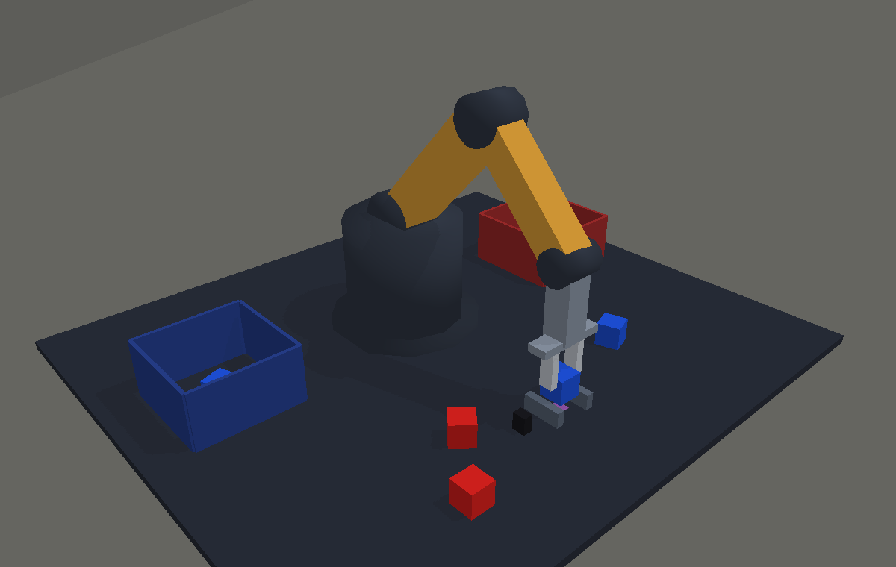

# ras-arm: cube-sorting robotic arm (IEEE RAS Build Challenge 2026, Project 3)

A 6-axis arm that picks red and blue cubes from a fixed cradle and sorts them into two bins.
Arduino UNO + CNC Shield V3 drive 3 steppers (TMC2209) and 4 servos (PCA9685); a TCS34725 reads the
colour, an E18 IR beam sees the cube arrive, NC limit switches home the arm, a latching E-stop cuts motor power.

This repo holds the **firmware** (C, PlatformIO, 6 strict layers, 23 PC tests) and a **React app**
(3D digital twin + move-to + teach mode over USB, plus a virtual mode that runs the whole firmware
logic in the browser without a board).

> 📷 *Photo of the arm: placeholder* · 🗺️ *Workcell diagram: placeholder*

```
           Bin A (red)  (0, +220)
                 ▲ +y
                 │
      base ●─────┼──────▶ cradle (220, 0)   +x
                 │        IR beam + colour sensor
                 ▼
           Bin B (blue) (0, −220)
```

## Architecture

| Layer | Folder | Job |
|---|---|---|
| 6 App | `firmware/src/6_app/` | `fsm` (11 states) · `console` (serial protocol, telemetry) |
| 5 Tasks | `firmware/src/5_tasks/` | `tasks` (homing, colour, pick, place, teach) · `decisions` ★ all tunable rules |
| 4 Motion | `firmware/src/4_motion/` | `kinematics` (IK/FK) · `motion` (moves, straight lines, saved poses) |
| 3 Joints | `firmware/src/3_joints/` | 7 joints in degrees (stepper or servo hidden), limits, speed limits |
| 2 Devices | `firmware/src/2_devices/` | steppers (DDA ISR, trapezoid) + servos + LED · sensors · serial link · EEPROM storage |
| 1 HAL | `firmware/src/1_hal/` | `hal.h` contract · `hal_avr.cpp` (UNO) · `test/test_arm/hal_fake.c` (PC) |

Calls only go down, one layer at a time; all numbers live in `config.h`. Details: [docs/architecture.md](docs/architecture.md).

**State machine**: `BOOT → HOMING → IDLE → READ_COLOUR → PICK → VERIFY → PLACE → RETURN → IDLE`, plus
`TEACH`, `ERROR`, `ESTOP`. Failed pick → jiggle retry (×2). Re-home every 10 cycles. → [docs/state_machine.md](docs/state_machine.md)

## Wiring & pinout (summary)

| Signal | Pin | | Signal | Pin |
|---|---|---|---|---|
| J1 STEP/DIR | D2/D5 | | Limit J1/J2/J3 (NC) | D9/D10/D11 (D12 option) |
| J2 STEP/DIR | D3/D6 | | E-stop sense | A0 |
| J3 STEP/DIR | D4/D7 | | E18 IR | A3 |
| Drivers EN | D8 (LOW = on) | | I²C (PCA9685 0x40, TCS34725 0x29) | A4/A5 |
| Status LED | D13 | | Servos J4/J5/J6/grip | PCA9685 ch 0/1/2/3 |

Full table, power and LED codes: [docs/wiring_pinout.md](docs/wiring_pinout.md).

## Serial protocol (summary)
115200 baud, one ASCII command per line, exactly one `OK <CMD>` / `ERR <CMD> <reason>` reply each,
`DONE <CMD>` when a move ends, `EV …` events, 20 Hz telemetry:
```
T,<ms>,<state>,<j1..j6 ×10>,<grip ×10>,<x>,<y>,<z>,<ir>,<colour>,<err>,<lim1><lim2><lim3>,<estop>
```
Commands: `PING STATUS HOME RUN STOP RESET TEACH DONE MOVE LINE MOVEJ JOG JOGJ GRIP SAVE GO POSES CAL SET`.
Full spec: [docs/serial_protocol.md](docs/serial_protocol.md).

## Firmware: build, flash, test
Needs [PlatformIO](https://platformio.org/install/cli) (`pipx install platformio`).
```bash
cd firmware
pio run -e uno                 # build (prints RAM / flash: 67.3 % / 86 %)
pio run -e uno -t upload       # flash the UNO
pio device monitor             # talk to it: PING, STATUS, TEACH, JOG 0 0 -5, SAVE CUBE, RUN …
pio test -e native             # 23 tests on your PC against a fake robot
```
Shield clone with Z− on D12? Add `-DLIMIT_Z_ON_D12` to `build_flags` in `platformio.ini`.

## App: digital twin + teach (sim/)
```bash
cd sim
npm i
npm run dev                    # http://localhost:5173
npm test                       # Vitest: protocol, golden IK vectors, virtual cycle/teach
npm run build                  # static site in sim/dist (GitHub Pages ready)
```
- **Virtual** mode: no board needed. The TypeScript twin of the firmware runs the same protocol and
  state machine. Place a red/blue cube, make the next pick fail, press the E-stop, cut a switch wire.
- **USB** mode: **Chrome or Edge** (Web Serial). Connect → pick the Arduino.
- Panels: 3D workcell to scale · Move-to (MOVE/LINE checked with the TS IK, MOVEJ/GRIP sliders) ·
  Teach (jog pad, per-joint jog, save/go poses, colour calibration) · Run (HOME/RUN/STOP/RESET, live
  state diagram, cycle counter) · Telemetry plots (20 s) · Serial console.

## Teach mode in 30 seconds
Enter TEACH → jog the open gripper around a cube in the cradle → **Save CUBE** → same for BIN_A,
BIN_B, HOME → CAL RED / CAL BLUE / CAL EMPTY with the cube on the sensor → Leave TEACH → RUN.
Walkthrough and bench test checklist: [docs/teach_mode.md](docs/teach_mode.md).

## Folder map
```
firmware/            PlatformIO project (env uno, env native)
  src/config.h       every number: pins, geometry, limits, speeds, timings, decision defaults
  src/1_hal … 6_app  the six layers
  test/test_arm/     fake robot (hal_fake.c) + Unity tests + generated IK vectors
pysim/               PyBullet physics sim: URDF from config.h, Python firmware twin, vision sort, keyframes,
                     GUI + console, pytest (CI job pysim)
sim/                 Vite + React 18 + TypeScript + react-three-fiber + zustand
  src/link/          ArmLink interface, SerialLink (Web Serial), VirtualLink, protocol.ts
  src/core/          kinematics.ts (port of the C IK), virtualFirmware.ts (FSM + motion twin)
  src/scene/         3D workcell, arm, cube, sensors
  src/panels/        UI panels
docs/                architecture, state machine, kinematics, wiring, protocol, teach mode, decisions
tools/               ik_reference.py (golden vectors), link_length_sweep.py (L1/L2 torque sweep)
.github/workflows/   CI: build uno, native tests, sim tests + build
```

## Kinematics, decisions
- IK/FK with the gripper kept vertical, conventions and stations: [docs/kinematics.md](docs/kinematics.md)
- Every decision rule (colour, 2-colour trick, jiggle, wiggle, pick-OK, re-home) and its parameter: [docs/decisions.md](docs/decisions.md)

## Physics simulation (pysim/)
The cell in PyBullet: the arm generated from `config.h`, real cubes with mass and friction, steppers that
can lose steps, servos, NC switches, the IR beam, a TCS34725 model, an E-stop that makes the arm go limp, and
a Python twin of the firmware (same states, decisions and protocol) driving it. Grasps, slips and drops are
physics, not script. On top, over the normal protocol: the RUN cycle with a cradle feeder, a vision sort
(overhead camera → OpenCV HSV → depth unprojection → pick anywhere on the table), and an ICRA-style keyframe player.
```bash
cd pysim && pip install -r requirements.txt
python run_sim.py                      # window with buttons + protocol console (!help)
python run_sim.py demo --headless      # RUN cycle, vision sort, keyframes; exit 1 if a cube ends up wrong
pytest tests                           # 21 tests: model vs firmware, the cycle and its faults, vision
```
Details, the sensor models and what the physics found: [pysim/README.md](pysim/README.md).



MIT licence.
