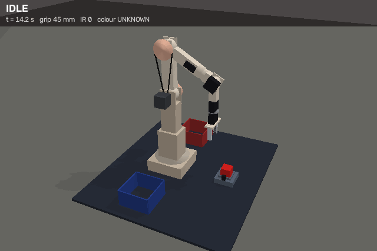
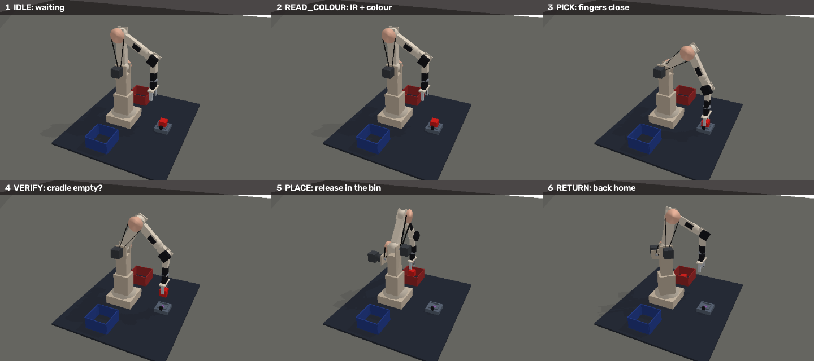
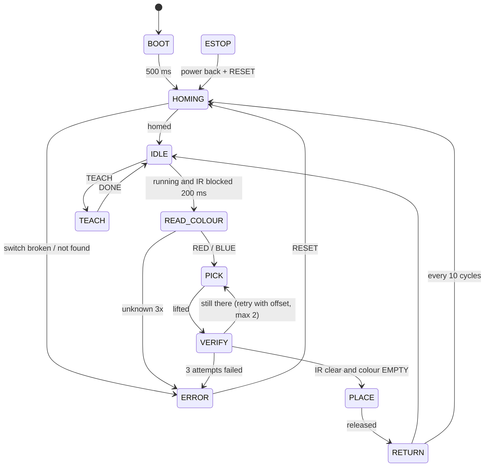
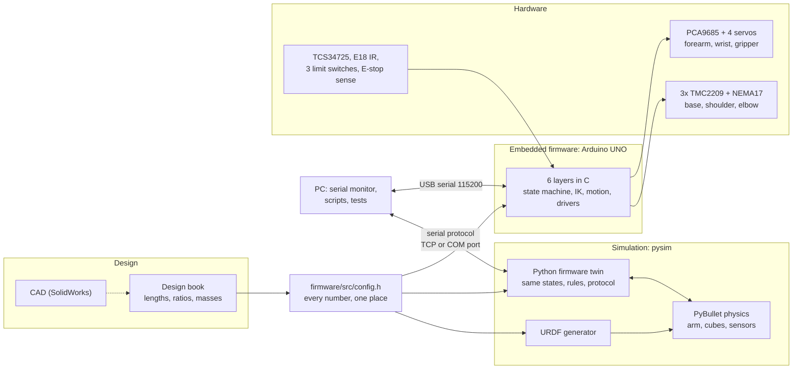
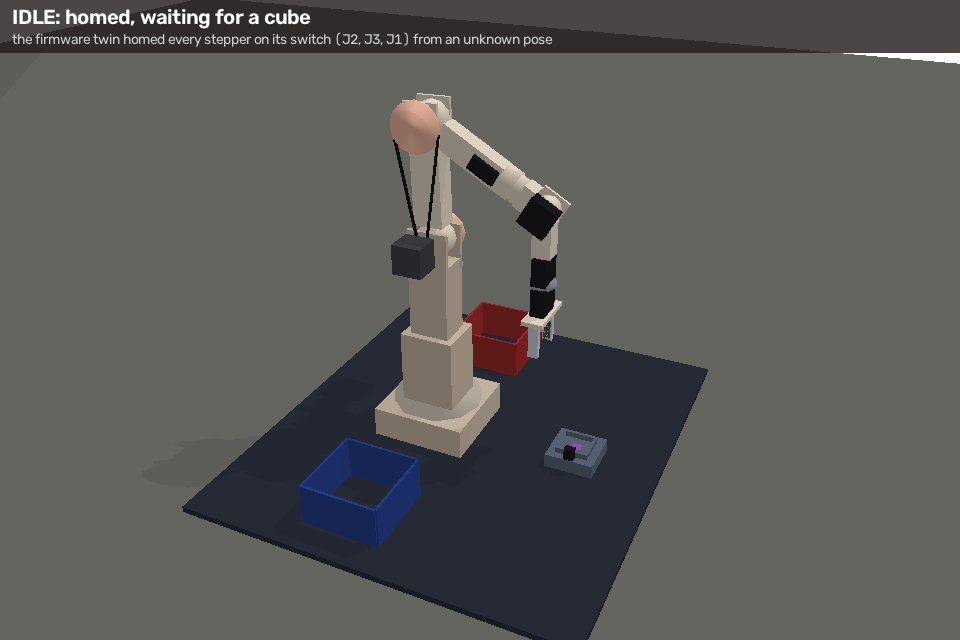
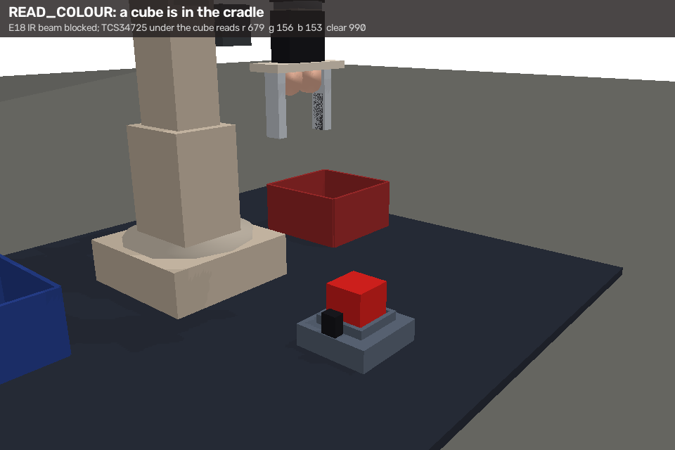
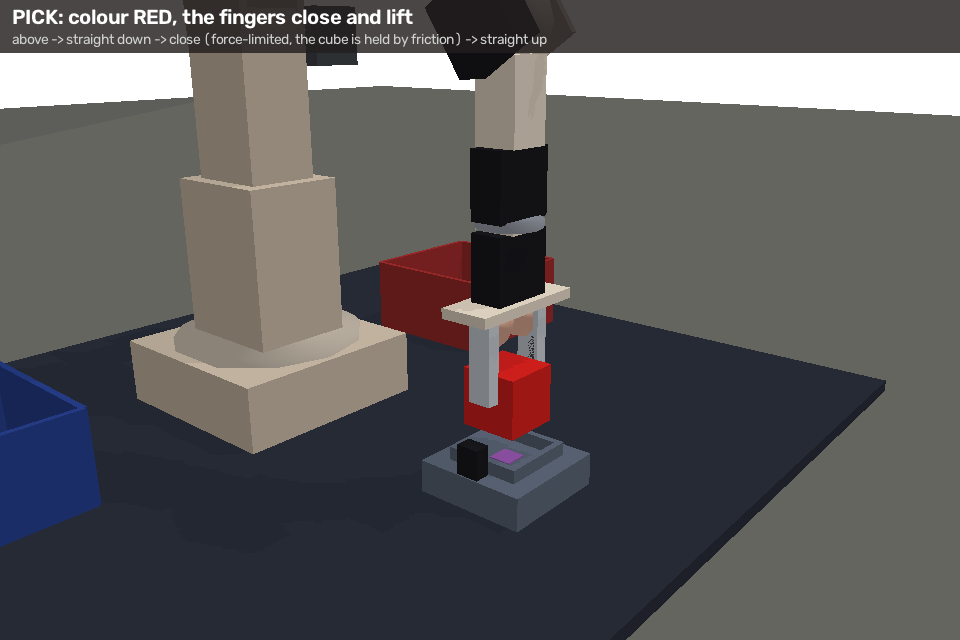
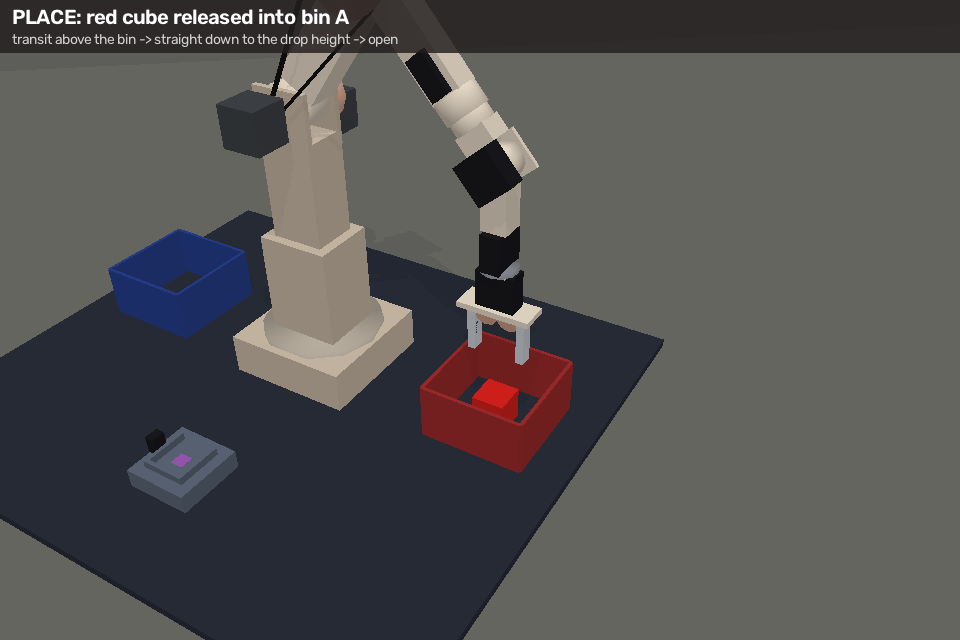
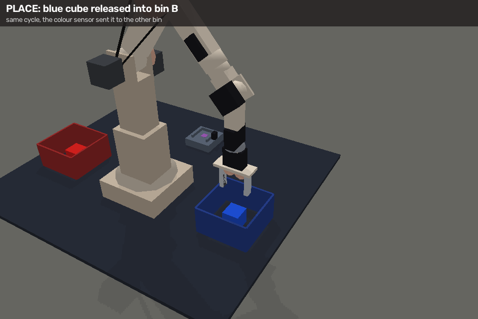
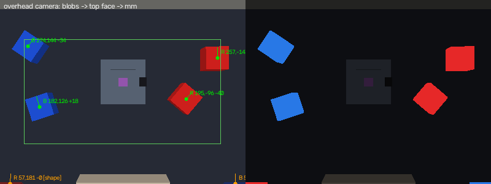

<h1 align="center">🦾 ras-arm</h1>

<p align="center">
  <b>A six-axis robotic arm that reads the colour of a cube and sorts it into the right bin.<br/>
  Designed, simulated with real physics, then built.</b><br/>
  IEEE RAS Build Challenge 2026 · Project 3: Robotic Arm · IEEE RAS Tunisia × ODC FabLab
</p>

<p align="center">
  <a href="https://github.com/Adam-BH/ras-arm/actions/workflows/ci.yml"></a>
  
  
  
  <a href="LICENSE"></a>
  
</p>

<p align="center">
  
  <br/><sub>One full cycle in the simulation (2× speed): the IR beam sees the cube, the colour sensor reads it, the arm
  picks it, checks the cradle is empty, drops it in its bin and goes home. Every move comes from the firmware's
  state machine; whether the cube stays in the fingers is physics.</sub>
</p>

---

## 📌 Overview

**The task** (RAS Build Challenge 2026, Project 3): a six-axis arm with a simple gripper and a colour sensor
must sort light objects of two colours, presented one by one at a fixed place, into two bins. It must home
every axis on its limit switches at start-up, and use full movement in all axes and rotations. Steppers drive
the base, shoulder and elbow; servos drive the wrist and the gripper. Kit parts only.

**From simulation to reality.** We design the arm on paper, prove it in a physics simulation that runs the
real firmware logic, then build it. The firmware is written once, in C, and tested on a PC against a fake
robot before any motor exists; the simulation reads the firmware's own `config.h`, so the virtual arm and the
real one share every number.

| Phase | Status |
|---|---|
| Design (lengths, motors, transmissions, electronics rev F, risks) | ✅ design book submitted 16 Nov 2026 <!-- TODO: add the design book PDF to docs/ and link it here --> |
| Firmware (UNO) | ✅ complete, 24 tests on a fake robot, builds at 67.5 % RAM |
| Physics simulation (`pysim`) | ✅ complete, 31 tests, runs the full cycle |
| Hardware build | 🔜 build phase 21 Nov – 11 Dec 2026 (TODO: photos and results) |

## ✨ Features

- **6 axes + gripper from the kit**: 3 NEMA17 steppers (base, shoulder, elbow) and 4 servos (forearm roll,
  wrist pitch, wrist roll, gripper); belts on large printed pulleys for stiffness; shoulder 300 mm up on a tower.
- **Standalone firmware** on an Arduino UNO: 6 strict layers in C, an 11-state machine, homing with
  broken-wire detection, colour decision rules, grip → verify → retry, E-stop handling, taught poses in EEPROM.
- **Checks itself**: a pick only counts if the IR beam **and** the colour sensor both say the cradle is
  empty; a miss is retried with a shifted grip; an unknown colour is re-read, never guessed.
- **Physics simulation** (`pysim`, PyBullet): the design book's arm, real cubes with mass and friction,
  simulated sensors and faults, and a Python twin of the firmware, so a full sorting cycle can be tested on a laptop.
- **Same serial port as the board**: the simulated arm speaks the UNO's exact protocol over TCP (or a COM
  port), so any serial tool can drive it as if it were the real arm.
- **Extras in simulation**: an overhead camera with OpenCV to pick cubes anywhere on the table, and a
  keyframe player for hand-made sequences.
- **Tested in CI** on every push: golden IK vectors, UNO build, firmware tests, simulation tests and a headless demo.

## ⚙️ How it works

<p align="center"></p>

**The cycle.** `IDLE` → the E18 IR beam is blocked for 200 ms → `READ_COLOUR` → `PICK` (above → straight
down → close → straight up) → `VERIFY` (the cradle must read empty) → `PLACE` (above the bin → down → open) →
`RETURN` home. A failed pick is retried twice with a shifted grip; every 10 cycles the arm re-homes to catch lost steps.

<details>
<summary><b>Perception: how the arm knows the colour</b></summary>

- **Presence**: an E18-D80NK IR sensor beside the cradle; the beam must stay blocked 200 ms.
- **Colour**: a TCS34725 in the cradle floor, looking up at the cube with its own LED. Five readings are
  averaged and divided by the clear channel (so room brightness does not matter), then compared with the
  calibrated red and blue references: a colour is accepted only if it is clearly closer to one of them
  (distance below 67 % of the distance to the other).
- **Two-colour trick**: if a reading is ambiguous, it is compared with the last cube sorted successfully:
  close to it means the same colour, otherwise the other one, since only two exist.
- **Empty cradle**: the clear channel drops below a calibrated threshold. Still unknown after 3 reads → `ERROR`,
  never a cube in the wrong bin.
- **Calibration on site**: `CAL RED`, `CAL BLUE`, `CAL EMPTY` in teach mode, saved in EEPROM with a CRC.
- **In simulation only**: an overhead camera + OpenCV (HSV colour classes, depth-buffer unprojection, top face
  only) finds loose cubes anywhere on the table. The real kit has no camera.

All rules and their parameters: [docs/decisions.md](docs/decisions.md).
</details>

<details>
<summary><b>Kinematics: from a target point to joint angles</b></summary>

The gripper always points straight down (`J5 = 180° − J2 − J3`), so the inverse kinematics reduces to a base
rotation plus a planar two-link arm, solved in closed form (about 1–2 ms on the UNO):

```
r  = √(x² + y²)             z_w = z + L3 − H              (wrist height above the shoulder)
cos J3 = (r² + z_w² − L1² − L2²) / (2·L1·L2)              rejected if > 0.995 (straight arm)
J3 = acos(cos J3)           J2 = atan2(r, z_w) − atan2(L2·sin J3, L1 + L2·cos J3)
J1 = atan2(y, x)            J5 = 180 − J2 − J3            J6 = roll − J1            J4 = 0
```

| Length | Value | Station | x, y, z (mm) | J2 / J3 / J5 |
|---|---|---|---|---|
| H (shoulder height) | 300 mm | HOME | 160, 0, 170 | −1.6° / 121.6° / 60.0° |
| L1 (shoulder → elbow) | 165 mm | GRIP (cube centre) | 220, 0, 37.5 | 51.0° / 100.1° / 28.9° |
| L2 (elbow → wrist pitch) | 190 mm | SAFE (transit) | 220, 0, 110 | 30.4° / 103.7° / 45.9° |
| L3 (wrist pitch → fingertip) | 200 mm | DROP (bins at ±90°) | 0, ±220, 88 | 36.2° / 103.6° / 40.2° |

Reach L1 + L2 = 355 mm. The C firmware and the Python twin are tested on the same 599 reference poses
(`tools/ik_reference.py`), and the stations match the design book's table within 0.05°.
Details: [docs/kinematics.md](docs/kinematics.md).
</details>

<details>
<summary><b>Motion planning: smooth, synchronised, approached from above</b></summary>

- **Synchronised trapezoidal moves** (25 % accelerate, 50 % cruise, 25 % brake): all joints start and stop
  together; the slowest joint sets the duration, so no joint exceeds its speed limit.
- **Straight lines** for every approach: the segment is cut every 10 mm and each point is checked with the IK
  **before** any motor turns.
- **From above**: pick and place are always above pose → straight down → straight up, with transit at
  110 mm (130 mm over the bins).
- **Steps from a 20 kHz timer interrupt** (Bresenham DDA): the three steppers move in proportion and finish
  together; servos follow the same duration with a ramp at 50 Hz.
</details>

<details>
<summary><b>Control: the state machine and the firmware layers</b></summary>



The E-stop is checked first in every loop, from any state; nothing blocks, so a stop always lands.

| Layer | Folder | Job |
|---|---|---|
| 6 App | `firmware/src/6_app/` | `fsm` (11 states) · `console` (serial protocol, 20 Hz telemetry) |
| 5 Tasks | `firmware/src/5_tasks/` | homing, colour, pick, place, teach · `decisions.c`: every tunable rule |
| 4 Motion | `firmware/src/4_motion/` | IK/FK · moves, straight lines, saved poses |
| 3 Joints | `firmware/src/3_joints/` | 7 joints in degrees, limits, speed limits |
| 2 Devices | `firmware/src/2_devices/` | stepper ISR, servos, sensors, serial link, EEPROM |
| 1 HAL | `firmware/src/1_hal/` | `hal_avr.cpp` on the UNO · `hal_fake.c` on a PC for the tests |

Calls only go down; every number lives in `firmware/src/config.h`.
More: [docs/architecture.md](docs/architecture.md) · [docs/state_machine.md](docs/state_machine.md) ·
[docs/serial_protocol.md](docs/serial_protocol.md).
</details>

## 🧭 System architecture



The firmware and its simulated twin read the same `config.h` and speak the same serial protocol, so a
script or test written against the simulation runs unchanged against the real arm.

## 🖥️ Simulation

The whole workcell in PyBullet: the arm generated from `config.h` with the design book's layout and masses,
a 35 mm cube on the raised V-cradle, two bins, steppers that can lose steps, servos, limit switches, the IR
beam, a colour-sensor model and an E-stop that makes the arm go limp. Nothing is scripted: whether a grasp
holds or where a dropped cube lands is physics.

<table>
  <tr>
    <td align="center"><br/><sub><b>1.</b> Homed and waiting</sub></td>
    <td align="center"><br/><sub><b>2.</b> Cube detected: IR beam + colour sensor</sub></td>
  </tr>
  <tr>
    <td align="center"><br/><sub><b>3.</b> Pick: the fingers close and lift</sub></td>
    <td align="center"><br/><sub><b>4.</b> Red cube → bin A</sub></td>
  </tr>
  <tr>
    <td align="center"><br/><sub><b>5.</b> Blue cube → bin B</sub></td>
    <td align="center"><br/><sub><b>6.</b> Simulation extra: the overhead camera finds loose cubes</sub></td>
  </tr>
</table>

```bash
cd pysim
python run_sim.py                          # window with buttons + a protocol console in the terminal
python run_sim.py cycle --cubes 6          # the RUN cycle: cubes are fed into the cradle and sorted
python run_sim.py vision --cubes 5         # the overhead camera finds loose cubes, the arm sorts them
python run_sim.py slides                   # a hand-made keyframe sequence
python run_sim.py demo --headless          # all three, no window, ends with a pass/fail report
python run_sim.py --serial tcp:5005        # + the board's serial port on socket://localhost:5005
```

<details>
<summary><b>Window controls, serial port and fault injection</b></summary>

- **Buttons** in the window: HOME, RUN, STOP, RESET, TEACH/DONE, put a red or blue cube in the cradle, feed
  6 cubes, scatter cubes, vision sort, play slides, camera snapshot, and faults (next grasp slips, E-stop,
  J1 skips steps, cut a switch wire, board reset).
- **Terminal**: any firmware command (`PING`, `STATUS`, `MOVE 200 50 100`, `TEACH`, `JOG 0 0 -5`, `CAL RED` …)
  goes to the simulated board; sim commands start with `!` (`!help`).
- **Serial port**: `--serial tcp:5005` behaves like the UNO's USB serial (115200 baud, `\n` lines, 20 Hz
  telemetry, the board resets when a host opens the port). Any pyserial program can use
  `serial.serial_for_url("socket://localhost:5005", 115200)`. On Windows a COM port works too, with a
  [com0com](https://sourceforge.net/projects/com0com/) pair: `--serial COM20`, then open COM21.
- `python make_readme_media.py` (needs `pip install pillow`) regenerates every picture on this page.

Full documentation: [pysim/README.md](pysim/README.md).
</details>

## 🔌 Hardware

<!-- TODO: photo of the built arm. Save it as docs/images/hardware_TODO.jpg and replace this comment with:
<p align="center"></p> -->
> 📷 **Photos of the real arm: TODO** (build phase, 21 Nov – 11 Dec 2026).

Everything runs standalone on an **Arduino UNO**; there is no Raspberry Pi in this design. A PC is only
needed to teach poses, calibrate the colours or watch the telemetry.

| Part | Qty | Role |
|---|---|---|
| Arduino UNO R3 | 1 | runs the whole firmware (RAM 67.5 %, flash 85.6 %) |
| TMC2209 stepper driver | 3 | one at each stepper joint (rev F, no CNC shield); 1/16 microstep on J1, 1/8 on J2, J3 |
| NEMA17 17HS4401S + PG518 5.18:1 gearbox | 1 | J2 shoulder, GT2 belt 16T → 88T (28.5:1 total) |
| NEMA17 17HS4401 | 2 | J1 base (direct, turntable on 4× 608ZZ), J3 elbow (belt 16T → 104T, 6.5:1) |
| PCA9685 16-channel PWM | 1 | servo pulses over I²C (0x40) |
| DS3218MG servo (20 kg·cm) | 2 | J4 forearm roll, J5 wrist pitch |
| MG996R servo | 2 | J6 wrist roll, gripper |
| TCS34725 colour sensor | 1 | in the cradle floor (I²C 0x29) |
| E18-D80NK IR sensor | 1 | cube present in the cradle |
| KW4 limit switch, wired NC | 3 | homing J1, J2, J3 (a broken wire reads "pressed") |
| 24 V 12.5 A power supply, 10 A fuse | 1 | main power |
| Latching E-stop (NC) | 1 | cuts the 24 V motor bus; the logic stays on and forces a re-home |
| XL4016 buck (6.5 V) / LM2596S buck (9 V) | 1 / 1 | servo rail / UNO Vin, taken before the E-stop |
| 608ZZ bearings | 10 | turntable 4, shoulder 2, elbow 2, forearm roll 2 |
| GT2 belt 6 mm + 16T pulleys | 0.69 m + 2 | shoulder and elbow drives |
| Printed parts (PLA, ODC FabLab) | 17 types | base, turntable, tower, links, 88T / 104T pulleys, gripper, V-cradle, bins |

<details>
<summary><b>Wiring (UNO pins) and power</b></summary>

| Signal | Pin | | Signal | Pin |
|---|---|---|---|---|
| J1 STEP / DIR | D2 / D5 | | Limit J1 / J2 / J3 (NC) | D9 / D10 / D11 |
| J2 STEP / DIR | D3 / D6 | | Motor-power sense (E-stop) | A0 |
| J3 STEP / DIR | D4 / D7 | | E18 IR | A3 |
| Drivers EN (LOW = on) | D8 | | I²C SDA / SCL | A4 / A5 |
| Status LED | D13 | | Servos J4 / J5 / J6 / gripper | PCA9685 ch 3 / 0 / 1 / 2 |

**Power**: 24 V supply → 10 A fuse → latching E-stop → 24 V bus (the three drivers and the XL4016 at 6.5 V for
the servos). The LM2596S feeds the UNO at 9 V **before** the E-stop, so the board keeps running, sees the stop
on A0 and requires a re-home.

Full pin table and LED codes: [docs/wiring_pinout.md](docs/wiring_pinout.md).
<!-- TODO: add the rev F wiring diagram (wiring_rev_F.png from the design files) to docs/images and link it here.
     docs/wiring_pinout.md still describes the CNC Shield layout; rev F mounts a TMC2209 at each joint (same pins). -->
</details>

<details>
<summary><b>Firmware: build, flash, test</b></summary>

Needs [PlatformIO](https://platformio.org/install/cli).

```bash
cd firmware
pio run -e uno                 # build for the UNO
pio test -e native             # 24 tests on your PC against a fake robot
pio run -e uno -t upload       # flash the UNO (board connected)
pio device monitor             # talk to it: PING, STATUS, TEACH, JOG 0 0 -5, SAVE CUBE, RUN …
```

**Teach mode in 30 seconds**: `TEACH` → `JOG` the open gripper around a cube in the cradle → `SAVE CUBE` →
same for `BIN_A`, `BIN_B`, `HOME` → `CAL RED` / `CAL BLUE` / `CAL EMPTY` → `DONE` → `RUN`.
Walkthrough and bench checklist: [docs/teach_mode.md](docs/teach_mode.md).
</details>

## 🚀 Installation and quick start

Python 3.10 or newer (tested with 3.12 on Windows 11 and Ubuntu in CI).

```bash
git clone https://github.com/Adam-BH/ras-arm.git
cd ras-arm/pysim
python -m venv .venv
.venv\Scripts\activate                # Windows   (Linux / macOS: source .venv/bin/activate)
pip install -r requirements.txt       # pybullet, numpy, opencv-python, pyserial, pytest
python run_sim.py demo --headless     # the full demo without a window (about 20 s)
pytest tests                          # 31 tests
python run_sim.py                     # the interactive window
```

> On some Python versions `pip` compiles PyBullet from source: on Windows this needs the
> [Microsoft C++ Build Tools](https://visualstudio.microsoft.com/visual-cpp-build-tools/).

## 🗂️ Project structure

```
ras-arm/
├── firmware/                  Arduino UNO firmware (PlatformIO)
│   ├── src/config.h           every number of the robot: pins, geometry, limits, speeds, rules
│   ├── src/1_hal … 6_app/     the six layers (HAL, devices, joints, motion, tasks, app)
│   └── test/test_arm/         fake robot + 24 Unity tests + golden IK vectors
├── pysim/                     physics simulation (PyBullet)
│   ├── run_sim.py             entry point: interactive, cycle, vision, slides, demo, --serial
│   ├── make_readme_media.py   regenerates the pictures of this README
│   ├── ras_sim/               world, URDF generator, firmware twin, serial bridge, vision, GUI
│   ├── tests/                 31 tests (model, firmware on physics, serial port, vision)
│   └── README.md              simulation details and findings
├── docs/                      architecture, state machine, kinematics, wiring, protocol, teach mode, decisions
│   └── images/                pictures and GIF of this README
├── tools/                     ik_reference.py (golden IK vectors), link_length_sweep.py (early sizing study)
├── .github/workflows/ci.yml   CI: IK vectors, UNO build, firmware tests, simulation tests, headless demo
└── LICENSE                    MIT
```

## 📊 Results and demo

**Simulation** (measured; the hardware is not built yet):

| What | Result |
|---|---|
| Full headless demo: 6 cradle cycles (one with a forced slip), vision sort of 6 loose cubes, 12 keyframes | 13 / 13 cubes in the correct bin, 1 automatic retry, 0 errors; 175 s simulated in about 20 s |
| Cycle time, cube in the cradle → back home (firmware's current timings) | 9.7 s per cube |
| Homing from an unknown pose | step counters within 0.04° of the switches |
| Overhead camera, 100 random 35 mm cubes | 100 / 100 found; centre error 0.71 mm mean, 1.13 mm max; yaw error ≤ 1.9° |
| Kinematics | matches the design book's station table within 0.05°; C and Python agree on 599 reference poses |
| Tests | firmware 24 / 24, simulation 31 / 31, UNO build RAM 67.5 % / flash 85.6 %, CI green |

**What the simulation found** (details in [pysim/README.md](pysim/README.md)):
- The design book's success test (10 cubes, 5 of each colour) sorts only **8 / 10 into the bins**: every cube
  is dropped at the same point, three 35 mm cubes stack higher than the release height, and the 4th of a colour
  is pushed over the bin wall. To fix before the demo (higher drop, deeper or sloped bins, or a drop point that moves).
- Opening the USB port resets the UNO and disables the steppers for about 1.6 s: the model predicts a 40 mm
  sag at HOME. To check on the bench.

**Design calculations** (from the design book, not measured): reach 355 mm, worst actuator load 65 % of usable
torque, repeatability 1.2 mm, cycle 7.2 s.

**Real hardware**: TODO: success-criterion run (10 cubes), measured cycle time, repeatability, demo video.

## 🛣️ Roadmap

- [x] Design book: kinematics, motors, transmissions, electronics rev F, risks, BOM
- [x] Firmware: complete, tested on a fake robot
- [x] Physics simulation with the firmware's logic and serial protocol
- [ ] M1 (21 Nov): hardware handover, every motor spins
- [ ] M2: homing and jog on all joints
- [ ] M3: first full sort cycle on the real arm
- [ ] M4: 10 / 10 cycles; fix the bin stacking found in simulation
- [ ] Final workshop (5–11 Dec): demo, code, CAD, BOM, test summary
- [ ] Real CAD meshes in the simulation (needs a STEP export of the SolidWorks assembly)

## 👥 Team

| Member | Role |
|---|---|
| **Youssef El Mhamdi** · Chairman, IEEE IAS INSAT SBC | physics simulation (`pysim`); TODO: build-phase role |
| Adam Bhouri | software and simulation lead (firmware, design model) per the design book; TODO: confirm |
| Mariem (TODO: full name) | electronics lead (wiring rev F, power, drivers) per the design book |
| Ilyes (TODO: full name) | TODO: role |

## 📄 License and acknowledgements

MIT License, see [LICENSE](LICENSE).

Thanks to **IEEE RAS Tunisia** for the RAS Build Challenge 2026 and the hardware kit, and to **ODC FabLab**
for printing the parts.
