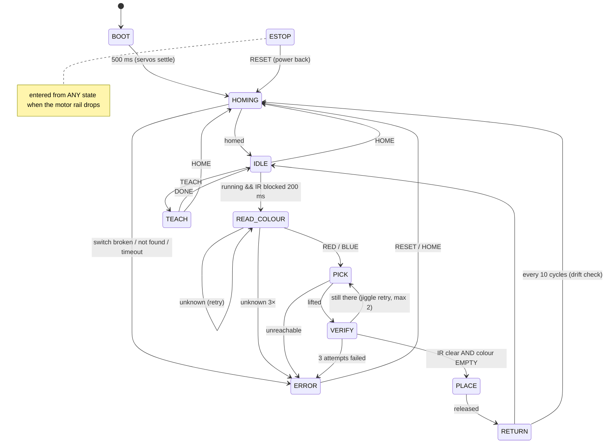

# State machine (`firmware/src/6_app/fsm.c`)

11 states, one `switch(state)` per loop, never blocks. Mirrored by `pysim/ras_sim/firmware.py`.

| State | Does | Leaves when |
|---|---|---|
| BOOT | servos to neutral, gripper open | 500 ms |
| HOMING | J2 → J3 → J1: leave switch if pressed → fast → back off → slow → set; then HOME pose | done → IDLE, failure → ERROR |
| IDLE | waits; accepts manual moves when not running | `RUN` + IR blocked 200 ms |
| READ_COLOUR | 5 readings averaged, `decide_colour()` | RED/BLUE → PICK; unknown 3× → ERROR |
| PICK | above (open) → line down → close (+ wiggle on retries) → line up | lifted → VERIFY |
| VERIFY | re-reads the cradle | IR clear + EMPTY → PLACE; else PICK with jiggle (2 retries) → ERROR |
| PLACE | transit above the bin → line down → open → line up | → RETURN |
| RETURN | HOME pose; counts the cycle | → IDLE, or HOMING every 10 cycles |
| TEACH | jog / save / go / calibrate | `DONE` |
| ERROR | motors stopped, `running` cleared, LED blinks the error code | `RESET` or `HOME` |
| ESTOP | motors stopped, `homed` cleared, LED solid | `RESET` once power is back |

**Manual moves** (`MOVE`, `LINE`, `MOVEJ`, `GRIP`; `JOG`, `JOGJ`, `GO`, `CAL` in TEACH only) use a
`manual` flag rather than a 12th state: they are accepted in IDLE (when not running) and TEACH,
one at a time; IDLE does not start a cycle while one runs; `STOP` aborts it.

**Status LED** (D13): heartbeat (1 s) when healthy · N blinks + pause = error code N · solid = E-stop.
