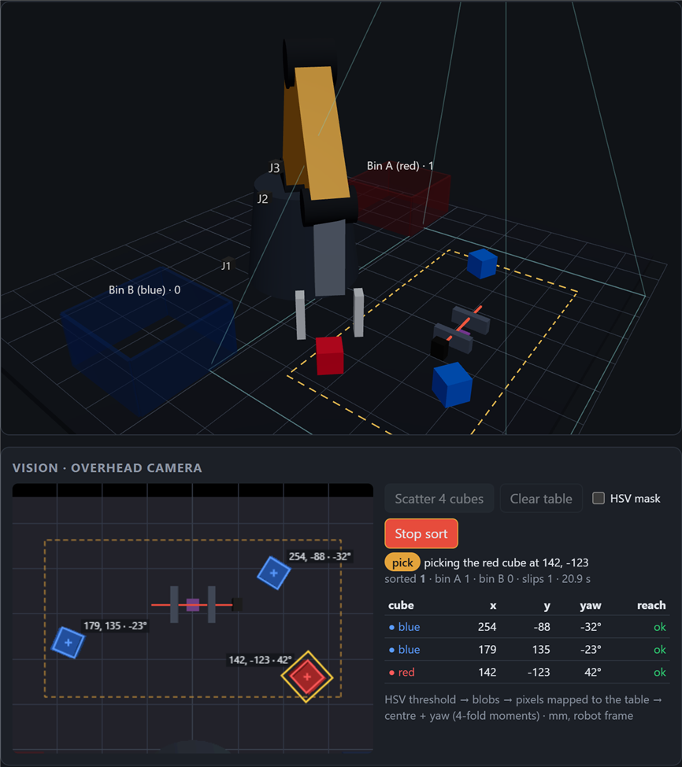
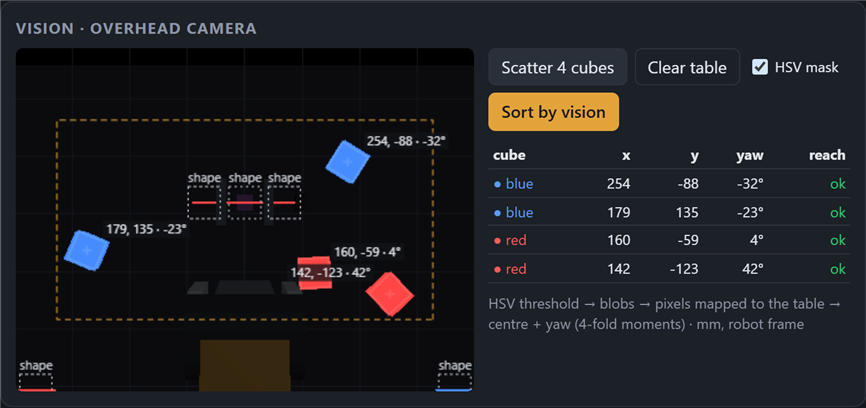
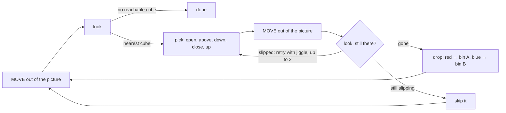

# Vision pick-and-place

An overhead camera finds red and blue cubes **anywhere on the table**, and the app sorts them into the
bins with the normal protocol (`STATUS`, `MOVE`, `GRIP`, `STOP`). **No firmware change**: the cradle cycle
(`RUN`) is untouched; vision sort is a host-side loop that runs while the arm is IDLE.



## Try it (virtual mode)
Connect → wait for IDLE → **Scatter 4 cubes** → **Sort by vision**.
- **HSV mask**: what the detector sees, and why the other blobs are rejected.
- **Next pick fails** (Virtual world panel): the camera catches the slip and the cube is picked again.

## Pipeline
```
camera frame ─▶ HSV per pixel ─▶ 4-connected blobs ─▶ every blob pixel → table mm (homography)
             ─▶ centre, yaw, area, elongation ─▶ filters ─▶ cubes (colour, x, y, yaw)
```

| Step | What | Code |
|---|---|---|
| Camera | The twin rendered from 500 mm above (205, 0), 33.4° vertical FOV, 400 × 300 px ≈ 1 px/mm. Render targets are linear (no tone mapping): encoded to sRGB like a camera | `scene/VisionCamera.tsx` |
| Colour | Red hue 345…15°, blue 195…250°, S ≥ 0.45, V ≥ 0.2. The table, the orange arm and the purple sensor pad stay out | `detect.ts` `pixelClass` |
| Blobs | Flood fill per colour, 4-connected, ≥ 30 px | `findBlobs` |
| Pixels → table | Each pixel goes through a 3 × 3 homography to the plane z = 12.5 mm. Mid-height, not the top face: a perspective camera also sees the side faces facing it, which pull the blob toward the image centre; unprojecting at mid-height cancels most of that | `geometry.ts`, `measure` |
| Centre | Mean of the mapped pixels | `measure` |
| Yaw | arg Σ (dx + i·dy)⁴ = 180° + 4·yaw. A square repeats every 90°, so the 4th harmonic of the blob points at its corners: yaw from all pixels, no corner hunting | `measure` |
| Filters | Elongation √(λmax/λmin) ≤ 2.2 (`shape`: the IR beam, bin edges) · 300…1500 mm² (`small` / `large`: two cubes touching) · inside the zone x 120…290, y −160…160 (`zone`) | `detect` |

Everything is measured **after** the homography, so the numbers come out in mm whatever the camera's
position, tilt or rotation: a different camera only changes the homography.



## Sort loop


- **Out of the picture**: every snapshot is taken with the arm parked at `VIEW_POSE` (40, −200, 170), off the zone.
- **Grasp roll**: the fingers must be square to the cube's faces: roll = yaw + k·90°, k chosen for the
  smallest J6 turn, then checked with the firmware IK at grip height and at `SAFE_Z` (`plan.ts` `graspRoll`).
  Cubes that fail show **out** in the panel and are left on the table.
- **Descent with `MOVE x y z roll ms`**, not `LINE`: `LINE` has no roll argument and would turn the
  fingers back to roll 0 on the way down. J1 and J6 stay fixed and the linear joint interpolation keeps
  J2 + J3 + J5 = 180°, so the gripper stays vertical.
- **Verify** like the firmware's VERIFY state, with the camera instead of IR + colour: the cube still within
  15 mm of where it was → slipped → retry with the jiggle offsets (R7 in [decisions.md](decisions.md)).
- **Taught poses**: grip height = taught `CUBE` z; drops at the taught `BIN_A` / `BIN_B`.
- Every motion waits for its `DONE`. `EV ERROR …` or `EV ESTOP` ends the run; **Stop sort** sends `STOP`.
- Starts only when `STATUS` says IDLE, homed, not running: the RUN cycle and vision sort don't mix.

## Accuracy (measured)
| Source | Cubes | Max centre error | Max yaw error |
|---|---|---|---|
| Synthetic frames, ±8 RGB noise, random yaw (`vision.test.ts`) | 200 | 0.72 mm | 2.3° |
| WebGL render of the twin (headless Edge, one layout) | 4 | 0.57 mm | 0.1° |

The virtual gripper holds a loose cube when it closes within 10 mm and 12° of the cube's faces.
End to end on the virtual arm, 4 cubes: 43 s; with a forced slip: 54 s, 1 retry, 4/4 sorted.

## Virtual world
`World.cube` is now `cradle` / `held` / `table`. Loose cubes have x, y, yaw. A cube let go away from a bin
or the cradle lands on the table under the gripper (it used to vanish), so the camera can find it again.
**Next pick fails** applies to loose cubes too.

## Tests
- `vision.test.ts`: pinhole ↔ homography round trip, least squares over noisy clicks, colour classes,
  detection accuracy (above), rejects (IR beam, off-zone cube, two touching cubes), scatter layouts.
- `sorter.test.ts`: the whole loop against `VirtualLink` (the firmware twin): 5 cubes sorted, slip → retry,
  the cradle cube, refuses while running, E-stop, stop, grasp alignment, drop on the table.
- `synthCamera.ts` projects boxes through the same pinhole model, so these run in Node without WebGL.

## Real arm: what is left
The loop only needs `capture()` and `pixelToTable` (`SorterIo` in `sorter.ts`):
1. **Frames**: webcam `getUserMedia` → canvas → `getImageData`: same RGBA layout as `Frame`.
2. **Calibration**: click 4 or more table points with known x, y (cradle centre, tape marks) →
   `solveHomography(pixels, table)` (least squares; tested with ±0.5 px click noise: < 1 mm).
3. **Thresholds**: re-tune `HSV` in the real light with the mask view.
4. **Mount**: anywhere that sees the zone. Keep the arm's `VIEW_POSE` out of the picture.
   A strongly tilted camera adds a few mm of side-face bias.

## Files
```
sim/src/vision/
  config.ts          camera, zone, thresholds, sort timing
  geometry.ts        pinhole projection · homography solve / apply / invert
  detect.ts          HSV → blobs → table centre, yaw, filters
  plan.ts            grasp roll + reach check · seeded scatter layouts
  sorter.ts          the closed loop over the protocol
  synthCamera.ts     software camera for the tests
sim/src/scene/VisionCamera.tsx    WebGL capture + camera / zone gizmo
sim/src/store/useVision.ts        live frame, detections, sort run
sim/src/panels/VisionPanel.tsx    the panel
```
