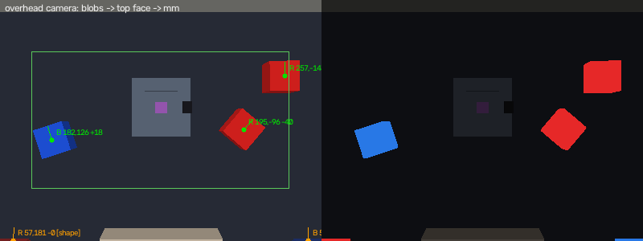

# pysim: physics simulation of the arm (PyBullet)

The design book's arm (RAS_Arm_Design_Book.pdf, 16 Nov 2026) in a physics engine, with its workcell, real
cubes with mass and friction, the sensors, and a Python twin of the firmware driving it. The twin talks
the board's serial protocol, and it can be reached from outside on a serial port, byte for byte like the
UNO. Nothing is scripted: whether a grasp holds, where a dropped cube lands, how far the arm sags when the
motors go off: that is physics.


## Run it
Python 3.10+ (tested on 3.12, Windows 11).
```bash
cd pysim
python -m venv .venv && .venv\Scripts\activate     # Linux / macOS: source .venv/bin/activate
pip install -r requirements.txt                     # pybullet builds from source on some Pythons (needs a C++ compiler)

python run_sim.py                      # interactive: buttons in the window, protocol console in the terminal
python run_sim.py cycle  --cubes 6     # the RUN cycle: a feeder puts cubes in the cradle, the arm sorts them
python run_sim.py vision --cubes 5     # overhead camera + OpenCV find loose cubes, the arm sorts them
python run_sim.py slides               # keyframe sequence (ras_sim/slides.py DEMO, or --file my.json)
python run_sim.py demo --headless      # all three, no window, ~8x real time, exit 1 if a cube ends up wrong
python run_sim.py --serial tcp:5005    # + the board's serial port (see "Serial port")
pytest tests                           # 31 tests, ~35 s
```
Options: `--serial tcp:PORT|COMx`, `--no-reset`, `--speed 2` (× real time),
`--seed N`, `--fail-pick` (the first grasp slips), `--log tel.csv` (the 20 Hz telemetry, same format as the
board), `--no-camera-window`, `--quiet`. `python run_sim.py urdf ras_arm.urdf` writes the generated URDF.

## The design book's arm, from config.h
`firmware/src/config.h` carries the design book's adopted design (appendix A.1 applied) and pysim reads it
at import, so the sim always follows the firmware:

| | value | design book |
|---|---|---|
| L1 / L2 (shoulder → elbow → wrist pitch) | 165 / 190 mm | Table 3 |
| L3 (wrist pitch → fingertip, gripper vertical) | 200 mm (100 link + 100 gripper) | Table 3 (T) |
| Shoulder height | 300 mm (base tower) | Sec. 2.4 |
| Steps / joint degree J2, J3 | 126.62, 28.89 (16T→88T, 16T→104T, 1/8) | Table 4 |
| PCA9685 channels J4, J5, J6, gripper | 3, 0, 1, 2 | rev F, Table 11 |
| Grip / drop height | 37.5 / 88 mm | Table 4 |
| Object, cradle (sim only) | 35 mm, 21 g cube on the 20 mm V-cradle | Sec. 1.3, P14 |

The stations reproduce Table 4 to 0.05° (`test_design_book_stations`); the IK port matches the C firmware on
the golden vectors of `tools/ik_reference.py` (`pysim/tests/ik_vectors.json`).

## What is simulated
| Layer | What | File |
|---|---|---|
| Robot | URDF generated from `config.h`: base housing (J1 motor underneath), turntable, 300 mm tower in two parts, shoulder fork, J2 17HS4401S + PG518 on the tower top 62 mm from the shoulder, J3 motor on the shoulder axis, GT2 belts on the 88T / 104T pulleys, 32 × 42 and 26 × 34 box links with Ø48 bosses, J4 at 140 mm with its DS3218MG, J5 DS3218MG, J6 MG996R, gripper (MG996R, gears A / B, parallel fingers, V-groove pads). Masses from Table 3 (ρ1, ρ2, elbow 97 g, servos, gripper 180 g). Joint names, signs and zero from docs/kinematics.md. `tool_tip` = firmware FK to 0.01 mm | `robot_urdf.py` |
| Torques | Rated, from the transmissions (Table 5): J1 0.49, J2 11.9, J3 3.03 N·m (usable = half), servos 1.96 / 1.96 / 1.08 | `config.py` |
| Steppers J1–J3 | Open loop: the firmware counts steps, the motor sits at count + **offset**. Unknown at power-up, re-learned by homing, changed by lost steps. Whole microsteps. Torque-limited | `world.py` |
| Servos J4–J6, gripper | Absolute, slew toward the command at their top speed. Fingers close on the cube with a force limit (the servo stalls on it), µ 0.4 (PLA on PLA, Sec. 3.2.1) | `world.py` |
| Hard stops | 3° past each homing switch | `robot_urdf.py` |
| Self-collision | The links collide with each other (not across a joint): a limp arm lands on its own tower | `world.py` |
| Limit switches | NC: pressed or broken wire reads pressed, from the real joint angle | `world.py` |
| E18 IR | A ray across the cradle, at the cube's lower half | `world.py` |
| TCS34725 | In the cradle floor: ambient + LED × cube colour × 1/(1+(d/8 mm)²) + 2 % noise. `CAL RED/BLUE/EMPTY` work on it | `world.py` |
| E-stop | Cuts the motor rail: every joint goes limp (detent × ratio + friction), the arm sags, a held cube falls | `world.py` |
| Board reset | EN pulled up (rev F): steppers off, servos keep their last pulse; 1.6 s later the sketch starts from scratch | `app.py` |
| Firmware | Python twin of `firmware/src/{3_joints … 6_app}`: 11 states, homing, pick / verify / place, decisions R1–R9, console (all 19 commands), telemetry, events | `firmware.py` |
| Serial port | The firmware's bytes on TCP or a COM port, with the UNO's framing and auto-reset | `serial_bridge.py` |
| Host scripts | Talk to the twin only through the protocol: cradle feeder, vision sort, keyframes | `app.py`, `feeder.py`, `sorter.py`, `slides.py` |

One clock: every 5 ms the firmware runs one loop, its commands go to the motors, physics runs 5 × 1 ms,
the serial port and each host script get a turn. Deterministic for a seed.

## Serial port: the same communication as the UNO
`--serial` puts the twin on a port that behaves like the board's USB serial (`docs/serial_protocol.md`):
115200 baud, ASCII lines ending in `\n`, `\r` ignored, characters past 71 dropped (`LINE_MAX`), one
`OK` / `ERR` reply per command, `DONE`, `EV …`, `POSE …` and the 20 Hz `T,…` telemetry, all ending in `\n`.
**Opening the port resets the board**, like the UNO's DTR auto-reset: 1.6 s of silence in the bootloader
(what the host sends meanwhile is lost), then `EV BOOT` and homing. `--no-reset` turns that off. One host at
a time, like a real port.

**TCP (works now, no driver):**
```bash
python run_sim.py --serial tcp:5005                       # with the window
python run_sim.py --serial tcp:5005 --headless            # no window: a board on the desk, until Ctrl-C
pio device monitor --port socket://localhost:5005 --baud 115200          # PlatformIO's monitor
python -m serial.tools.miniterm socket://localhost:5005 115200           # pyserial's terminal
```
Any pyserial program works unchanged: `serial.serial_for_url("socket://localhost:5005", 115200)` instead of
`serial.Serial("COM5", 115200)`.

**A COM port (Arduino serial monitor, PuTTY, any COM-port program):** Windows needs a virtual null-modem
pair. Install [com0com](https://sourceforge.net/projects/com0com/) (signed driver, admin rights), create a
pair, e.g. COM20 ↔ COM21, then:
```bash
python run_sim.py --serial COM20
```
and open **COM21** in the other program. The board resets when the program opens the port (com0com passes DTR to the sim as DSR), exactly like plugging in the UNO.

The window shows the port's status and line counts; **Board reset** (or `!reset`) resets it by hand.

## Interactive mode
**Buttons** (parameter panel on the right of the PyBullet window): HOME, RUN, STOP, RESET, TEACH/DONE,
+ red / + blue cube in the cradle, Feeder (RUN + 6 cubes), Scatter 5 cubes, Vision sort, Play slides,
Camera snapshot, Clear cubes, the faults (next grasp slips, E-stop, J1 skips 6°, J2 switch wire) and Board
reset. A slider sets the speed. The overlay shows state, error, tip, grip, IR, colour, bins, the last event
and the serial port.

**Terminal**: any firmware command (`PING`, `STATUS`, `TEACH`, `JOG 0 0 -5`, `SAVE CUBE`, `CAL RED`,
`MOVE 200 50 100`, `SET grip_wiggle 8` …) goes to the twin. Sim commands start with `!`: `!red`, `!blue`,
`!scatter 4`, `!feed 6`, `!sort`, `!slides`, `!fail`, `!estop`, `!lose 1 5`, `!break 2`, `!snap`, `!reset`,
`!speed 2`, `!bins`, `!clear`, `!quit`, `!help`.

## Vision sort


Overhead camera (400 × 300 px from 500 mm above (205, 0)) → OpenCV HSV classes → blobs → every pixel
unprojected through the depth buffer → top face only → centre, yaw, size → filters (shape, size, zone).
The loop uses only `STATUS` / `MOVE` / `GRIP`: park out of the picture → look → nearest reachable cube →
fingers square to its faces → grip at the cube's measured centre height (table or cradle) → look again
(still there → slipped → retry with the jiggle offsets) → drop, spread over 4 spots per bin.
Same idea as the ICRA arm's vision pipeline.

## Keyframes ("slides")
A list of poses visited in order, each joint angles (J1..J6, sent as `MOVEJ`) or a tip pose (`MOVE`, solved
by the firmware IK); the gripper acts **before** the arm moves in that slide. Edit `DEMO` in
`ras_sim/slides.py`, or `--file` a JSON list: `[{"pose": [160, 0, 170, 0], "gripper": "open", "duration": 1.5}]`.

## Tests (`pytest tests`, 31)
- **Model**: `config.h` parse · `config.h` = the design book (A.1 values, Table 5 torques, ratios) · IK vs the
  golden vectors · **Table 4 stations** · URDF tip vs firmware FK ·
  gripper vertical, fingers follow roll · hard stops past the switches.
- **Firmware on physics**: console, telemetry, homing from an unknown pose, red → A / blue → B, slip → retry,
  out of retries → `PICK_FAILED`, step loss (small → re-home fixes it; large → `PICK_FAILED` → `RESET`),
  broken switch wire, E-stop sag + `RESET`, TEACH / `CAL RED`.
- **Serial port** (a real pyserial client): reset on open + bootloader eats input, framing (`\r`, empty
  line, split writes, two lines in one write, 71-char cut, unknown), `DONE` + 20 Hz telemetry, one host at a
  time, reconnect resets, `--no-reset`.
- **Vision**: accuracy, no false cubes, grasp roll, full sort with a slip, keyframe demo.

## Found by the physics (design-book arm)
- **The success criterion of Sec. 1.2 fails in the bins, not in the arm.** Ten cubes, five of each colour, one
  after the other (`python run_sim.py cycle --cubes 10 --headless`): every pick and colour is right, the
  firmware reports 10 good cycles, but only **8 / 10 end in a bin**. The RUN cycle drops every cube at the one
  taught bin pose; 35 mm cubes released from 88 mm (cube bottom at 70.5 mm) stack: two make 70 mm, three make
  105 mm, and the 4th cube of a colour hits that tower on the way down and is pushed over the 60 mm wall.
  Options to try in the sim before deciding: a higher drop (`CELL_DROP_Z`), deeper bins, a sloped bin floor
  that rolls cubes away from the drop point, or a drop point that moves per cycle (firmware).
- **Opening the serial port drops the arm.** The UNO resets when a host opens the port, and with rev F's EN
  pull-ups the steppers are off for the ~1.6 s of the bootloader. Idle at HOME the tip sags 40 mm; holding a cube
  over a bin it falls 96 mm and the cube lands on the table. This rests on the model's unpowered holding torque
  (detent × ratio + friction, `SIM.unpowered_hold`): worth one bench check (press the UNO's reset at HOME).
  For the demo (standalone, R12) it does not matter; while developing with a PC connected, avoid
  reconnecting mid-move, or disable auto-reset (10 µF between RESET and GND).
- The E-stop finding of the first version (homing jammed by a re-grabbed cube after `RESET`) was on the old
  180/140 arm; on the design-book arm the same scenario homes fine.

## Files
```
pysim/
  run_sim.py           CLI: interactive, cycle, vision, slides, demo, urdf; --serial
  ras_sim/config.py    config.h parser (FW) + sim parameters (SIM)
  ras_sim/kinematics.py, protocol.py      ports of kinematics.c and of the console protocol
  ras_sim/robot_urdf.py                   the design book's arm as a URDF
  ras_sim/world.py     PyBullet cell: arm drive (steppers, servos, EN, E-stop), cradle, cubes, sensors, faults
  ras_sim/firmware.py  the firmware twin (FSM, tasks, decisions, console, telemetry)
  ras_sim/app.py       Simulation: one clock for physics, firmware, serial port and host scripts; board reset
  ras_sim/serial_bridge.py                the twin on TCP or a COM port, framed like the UNO
  ras_sim/vision.py    overhead camera, HSV, depth unprojection, detections, debug images
  ras_sim/sorter.py    vision sort loop, grasp roll, scatter
  ras_sim/slides.py    keyframe sequencer + DEMO
  ras_sim/feeder.py    cradle feeder for the RUN cycle
  ras_sim/gui.py       PyBullet buttons + overlay, terminal console, OpenCV camera window
  img/                 renders for this page
  tests/               model, firmware on physics, serial port, vision; ik_vectors.json (golden IK vectors)
```
