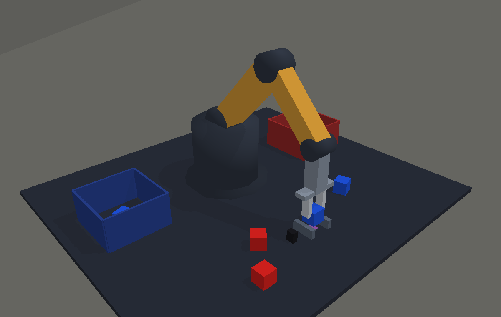
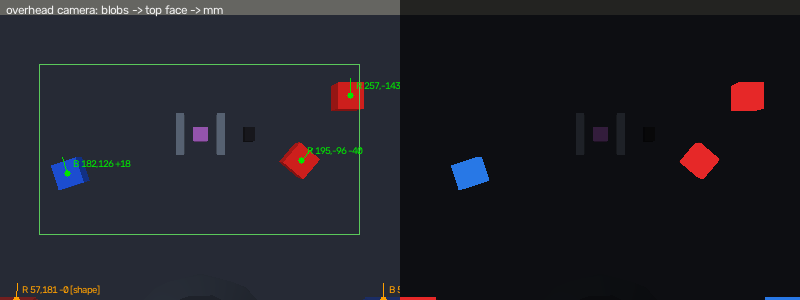

# pysim: physics simulation of the arm (PyBullet)

The whole cell in a physics engine: the arm built from `config.h`, the cradle, the bins, real cubes with
mass and friction, the sensors, and a Python twin of the firmware driving it over the serial protocol.
Nothing is scripted: whether a grasp holds, where a dropped cube lands, how far the arm sags on an E-stop
is physics. Same idea as the web twin's virtual mode, one level closer to the bench.



## Run it
Python 3.10+ (tested on 3.12, Windows 11).
```bash
cd pysim
python -m venv .venv && .venv\Scripts\activate     # Linux / macOS: source .venv/bin/activate
pip install -r requirements.txt                     # pybullet builds from source on some Pythons (needs a C++ compiler)

python run_sim.py                      # interactive: buttons in the window, protocol console in the terminal
python run_sim.py cycle  --cubes 6     # the RUN cycle: a feeder puts cubes in the cradle, the arm sorts them
python run_sim.py vision --cubes 5     # overhead camera + OpenCV find loose cubes, the arm sorts them
python run_sim.py slides               # keyframe sequence (ras_sim/slides.py DEMO, or --file my.json)
python run_sim.py demo --headless      # all three, no window, ~9x real time, exit 1 if a cube ends up wrong
pytest tests                           # 21 tests, ~25 s
```
Options: `--speed 2` (× real time), `--seed N`, `--fail-pick` (the first grasp slips), `--log tel.csv`
(the 20 Hz telemetry, same format as the board), `--no-camera-window`, `--quiet`.
`python run_sim.py urdf ras_arm.urdf` writes the generated URDF.

## What is simulated
| Layer | What | File |
|---|---|---|
| Robot | URDF generated from `config.h` (lengths, limits) with the ROS 2 twin's chain, joint names, signs and zero. Placeholder shapes, masses and torques from `hardware.yaml` (feature/ros2-twin). PyBullet `tool_tip` = firmware FK to 0.01 mm | `robot_urdf.py` |
| Steppers J1–J3 | Open loop: the firmware counts steps, the motor sits at count + **offset**. Unknown at power-up (the arm starts at 20°, 40°, 90°, the firmware believes 0°), re-learned by homing, changed by lost steps. Whole microsteps. Torque-limited | `world.py` |
| Servos J4–J6, gripper | Absolute, slew toward the command at their top speed. Fingers close on the cube with a force limit (the pads sit 1 mm inside the nominal opening, so `GRIP_CLOSED_MM` 26 presses the 25 mm cube like the real servo stalling) | `world.py` |
| Hard stops | 3° past each homing switch, so the switch clicks before the mechanics stop the joint | `robot_urdf.py` |
| Limit switches | NC: pressed or broken wire reads pressed, from the real joint angle | `world.py` |
| E18 IR | A ray across the cradle pocket at 12.5 mm: the cube (or anything) blocks it | `world.py` |
| TCS34725 | LED light reflected by the cube on the sensor: ambient + gain × cube colour × 1/(1+(d/8 mm)²) + 2 % noise. Calibration (`CAL RED/BLUE/EMPTY`) works on it | `world.py` |
| E-stop | Cuts the motor rail: every joint goes limp (detent / gearbox friction only), the arm sags, a held cube falls; steppers re-energise wherever the arm ended up | `world.py` |
| Firmware | Port of `virtualFirmware.ts`: 11 states, homing, pick / verify / place, decisions R1–R9, console (all 19 commands), telemetry, events | `firmware.py` |
| Host scripts | Talk to the twin **only through the protocol** (send a line, wait for `OK` / `DONE`): cradle feeder, vision sort, keyframes | `app.py`, `feeder.py`, `sorter.py`, `slides.py` |

Every robot number is read from `firmware/src/config.h` at import (`config.py` parses the defines, arrays
and enums): change the CAD there and the sim follows. Sim-only numbers (cube mass, friction, camera,
sensor model) are in `SimParams` in the same file. One clock: every 5 ms the firmware runs one loop,
its commands go to the motors, physics runs 5 × 1 ms, each host script gets a turn. Deterministic for a seed.

## Interactive mode
**Buttons** (parameter panel on the right of the PyBullet window): HOME, RUN, STOP, RESET, TEACH/DONE,
+ red / + blue cube in the cradle, Feeder (RUN + 6 cubes), Scatter 5 cubes, Vision sort, Play slides,
Camera snapshot, Clear cubes, and the faults: next grasp slips, E-stop (toggle the rail), J1 skips 6°,
J2 switch wire (toggle). A slider sets the speed. The overlay shows state, error, tip, grip, IR, colour,
bins and the last event; the IR beam turns green when blocked; the camera's field of view is drawn on the table.

**Terminal**: any firmware command (`PING`, `STATUS`, `TEACH`, `JOG 0 0 -5`, `SAVE CUBE`, `CAL RED`,
`MOVE 200 50 100`, `SET grip_wiggle 8` …) goes to the twin as if typed in `pio device monitor`. Sim
commands start with `!`: `!red`, `!blue`, `!scatter 4`, `!feed 6`, `!sort`, `!slides`, `!fail`, `!estop`,
`!lose 1 5` (J1 skips 5°), `!break 2`, `!snap`, `!speed 2`, `!bins`, `!clear`, `!quit`, `!help`.

## Vision sort


Like the ICRA arm's pipeline and the web twin's vision sort (feature/vision-sort), on PyBullet's renderer:
1. **Camera**: 400 × 300 px RGB-D from 500 mm above (205, 0), image up = robot +x. Same placement as the web twin.
2. **HSV** (OpenCV): red 0–8 ∪ 172–180, blue 100–128, S ≥ 110, V ≥ 50. Table, arm, sensor pad stay out.
3. **Blobs** → **every pixel unprojected** through the depth buffer (inverse projection × view) → only the top
   face kept (highest 3 mm), so the side faces don't pull the centre → centre, yaw (`minAreaRect`), size.
4. **Filters**: shape (bin edges), small, large (two cubes touching), outside the pick zone.
5. **Loop** (`sorter.py`, only `STATUS` / `MOVE` / `GRIP`): park out of the picture → look → nearest reachable
   cube → fingers square to its faces (roll = yaw + k·90°, smallest J6 turn the IK accepts) → down in two short
   moves → close → up → look again: still there → slipped → retry with the jiggle offsets (R7) → bin. Drops are
   spread over 4 spots per bin (one spot builds a tower).

Measured on 100 random cubes: **0.7 mm mean, 1.2 mm max** centre error, **1.7° max** yaw error, 8 ms per frame.

## Keyframes ("slides")
Like the ICRA sequencer: a list of poses visited in order, each either joint angles (J1..J6, firmware
convention, sent as `MOVEJ`) or a tip pose (`MOVE`, solved by the firmware IK). The gripper acts **before**
the arm moves in that slide.
```python
Slide(pose=(220, 0, 24, 0), duration=1.6, label="down to the cube"),
Slide(pose=(220, 0, 24, 0), gripper="close", duration=0.3, label="grasp"),
Slide(joints=[90, 25, 85, 0, 70, -90], duration=2.0, label="swing over bin A"),
```
Edit `DEMO` in `ras_sim/slides.py`, or `--file` a JSON list: `[{"pose": [160, 0, 170, 0], "gripper": "open", "duration": 1.5}]`.

## Tests (`pytest tests`)
- **Model**: `config.h` parse · IK/FK vs the golden vectors of `tools/ik_reference.py` (same as C and TS) ·
  URDF tip vs firmware FK on 300 poses · gripper vertical, fingers follow roll · hard stops past the switches.
- **Firmware on physics**: console replies · telemetry · homing from an unknown pose · red → A, blue → B ·
  slipped grasp retried · out of retries → `PICK_FAILED`, cube still in the cradle · 1.5° step loss → still
  picks, re-home fixes it · 15° step loss → `PICK_FAILED` → `RESET` → back to work · broken switch wire ·
  E-stop sag + `RESET` refused until the rail is back · TEACH jog / save / `CAL RED` on the physical cube.
- **Vision**: accuracy, no false cubes on the empty cell, grasp roll, full sort with a slip, keyframe demo.

## Found by the physics
- **E-stop with a cube in the gripper, then RESET → HOMING fails** (`HOME_FAIL not_found 3`). The limp arm
  sags onto the table and drops the cube under the open-ish fingers; when the rail comes back the gripper is
  still commanded closed and grabs it again; homing then folds J3 and jams the cube against the turret until
  J3 stalls. With the gripper opened when HOMING starts, the same run homes fine. Suggestion:
  `task_homing_start()` opens the gripper (BOOT already does, RESET → HOMING doesn't).
- **Bins fill as towers**: the RUN cycle drops every cube at the taught bin point, so they stack (3 cubes =
  75 mm, above the 60 mm walls). 8 cubes in one bin still worked (they tumble into two piles), but expect it
  on the bench; the vision sort spreads its drops.

## Files
```
pysim/
  run_sim.py           CLI: interactive, cycle, vision, slides, demo, urdf
  ras_sim/config.py    config.h parser (FW) + sim-only parameters (SIM)
  ras_sim/kinematics.py, protocol.py      ports of kinematics.c / protocol.ts
  ras_sim/robot_urdf.py                   the arm's URDF from config.h
  ras_sim/world.py     PyBullet cell: arm drive (steppers, servos, E-stop), cubes, sensors, faults
  ras_sim/firmware.py  the firmware twin (FSM, tasks, decisions, console, telemetry)
  ras_sim/app.py       Simulation: one clock for physics, firmware and host scripts
  ras_sim/vision.py    overhead camera, HSV, depth unprojection, detections, debug images
  ras_sim/sorter.py    vision sort loop, grasp roll, scatter
  ras_sim/slides.py    keyframe sequencer + DEMO
  ras_sim/feeder.py    cradle feeder for the RUN cycle
  ras_sim/gui.py       PyBullet buttons + overlay, terminal console, OpenCV camera window
  tests/               model, firmware-on-physics, vision
```
