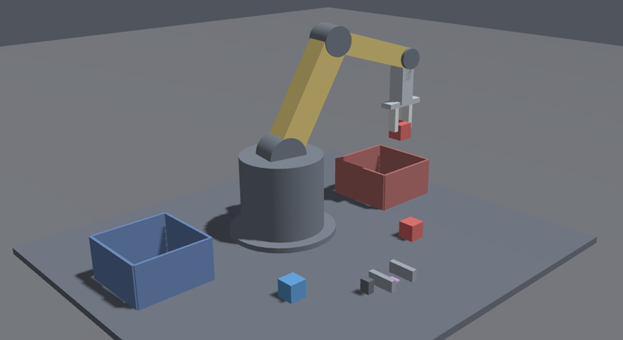

# ros2/: the digital twin in ROS 2 + Gazebo

The ras-arm as a ROS 2 robot: URDF, Gazebo workcell, ros2_control. Same joints, same zero, same signs as
the firmware, and every number comes from `firmware/src/config.h`.

| Package | What |
|---|---|
| `ras_arm_description` | URDF (xacro) of the arm and the workcell, RViz view, tests against the firmware |
| `ras_arm_gazebo` | Gazebo world, ros2_control (trajectory controller + gripper), cubes, the RUN cycle as a demo |

ROS 2 **Lyrical** + Gazebo **Jetty** on Ubuntu 26.04 (Windows: WSL2, GUIs through WSLg).



## Firmware ↔ ROS
| Firmware | ROS |
|---|---|
| J1…J6 in degrees (`MOVEJ`, telemetry) | joints `J1`…`J6` in rad, same zero and sign |
| grip opening in mm | joint `grip_left` = opening / 2 in m (`grip_right` mimics it); links `finger_left`, `finger_right` |
| tip x, y, z, roll (`MOVE`, telemetry) | frame `tool_tip` in `world`; roll = yaw of the finger axis (tool y) |
| `config.h` geometry, limits, speeds, workcell | `ras_arm_description/config/arm.yaml`, **generated**: `python3 tools/gen_ros_config.py` (CI fails if stale) |

Zero pose = every joint 0: the arm straight up, fingers up, facing +x (the cradle).
J2 + J3 + J5 = 180° points the gripper down. J6's axis is −z of the wrist so that the fingers' world yaw is
J1 + J6, the firmware's roll. Details: [docs/kinematics.md](../docs/kinematics.md).

## Setup (once)
```bash
# ROS 2 Lyrical + Gazebo Jetty: docs.ros.org/en/lyrical → Installation → Ubuntu (deb packages), then
sudo apt install ros-lyrical-desktop ros-dev-tools ros-lyrical-ros-gz ros-lyrical-gz-ros2-control \
  ros-lyrical-ros2-controllers ros-lyrical-ros2controlcli ros-lyrical-xacro ros-lyrical-joint-state-publisher-gui
# WSL: let your user reach the GPU (else Gazebo cannot render: "OpenGL 3.3 is not supported"), then
# restart WSL (PowerShell: wsl --terminate Ubuntu)
sudo usermod -aG render,video $USER
# workspace (from WSL, the repo stays on the Windows side)
mkdir -p ~/ras_ws/src && ln -s /mnt/c/Users/<you>/ras-arm/ros2 ~/ras_ws/src/ras_arm
cd ~/ras_ws && source /opt/ros/lyrical/setup.bash
rosdep install --from-paths src --ignore-src -y
colcon build && source install/setup.bash
```

## Run
```bash
ros2 launch ras_arm_description display.launch.py      # RViz + a slider per joint (no physics)
ros2 launch ras_arm_gazebo sim.launch.py               # Gazebo: workcell, arm, 3 cubes, controllers
ros2 run ras_arm_gazebo demo_cycle.py --bin A          # in a 2nd terminal: the RUN cycle on the twin
ros2 run ras_arm_gazebo demo_cycle.py --bin B --check  # … and exit 1 unless the cube landed in the bin
ros2 launch ras_arm_gazebo sim.launch.py gui:=false rviz:=true   # physics headless, RViz view
```
The demo uses the firmware's IK, speed limits, ramp and timings: `MOVE` above the cradle, `LINE` down at
40 mm/s, close, `LINE` up, `MOVE` above the bin, `LINE` down, open, up, home. The cube is really grasped:
contacts, friction, gravity. Checked 6 / 6 runs (bins A and B, fresh sim each), the tip back at HOME to
the millimetre.

**Grasping in the twin.** `GRIP_CLOSED_MM` (26) is 1 mm wider than the cube: the real servo closes on it
and stalls. The twin's fingers are exact, so the demo commands 2 mm past it per side (`SQUEEZE`): they stop
on the cube and press with their effort limit (`hardware.yaml`), like the stalled servo. The placeholder
fingers reach 7 mm past the firmware's tip (the grasp point, z = 24 mm when picking), so the pads hold the
cube's top 8 mm, above the 16 mm cradle walls; the CAD fingers replace this.

Two runs side by side (or a quick restart after a crash) need their own Gazebo partition:
`GZ_PARTITION=run2 ROS_DOMAIN_ID=2 ros2 launch …`.

Controllers: `/arm_controller/follow_joint_trajectory` (J1…J6) and `/gripper_controller/follow_joint_trajectory`
(`grip_left`, m), both `control_msgs/FollowJointTrajectory`; `/joint_states`. The mimic finger is driven by
gz_ros2_control; Gazebo's default physics engine logs once that it has no native mimic constraint: expected.

## Tests
```bash
colcon test --packages-select ras_arm_description && colcon test-result --verbose
```
`test_urdf.py`: joint limits = config.h, zero pose straight up, finger gap = grip value, the Gazebo
variant starts at HOME, the workcell at the config.h positions, and **forward kinematics through the URDF
tree lands on the firmware's golden IK vectors** (the same file the C firmware and the TypeScript twin
are tested against) within 1 µm, gripper pointing down, finger yaw = roll; once the CAD is in, every mesh
sits where the CAD had it and on its link. CI runs them on every push (`ros:lyrical-ros-base`).
In the sim: `demo_cycle.py --check`. For the CAD path: `tools/cad_import.py selftest`.

## CAD
Until a link has a mesh it is drawn with placeholder shapes (the web twin's sizes); collisions always
use the simple shapes (fast, stable physics). To bring in the real geometry:

**1. Pose the assembly in the zero pose**: every joint at 0, the arm straight up, fingers up, the arm
facing the cradle. Origin on the J1 axis at table level, X toward the cradle, Z up (if the CAD's origin
is elsewhere, add a coordinate system there and export relative to it).

**2. Export**, either:
- **one STEP of the whole assembly** (easiest: part names and positions survive), or
- **one binary STL per link, in mm, in assembly coordinates**, named `<link>.stl` (table below):
  SolidWorks: Save As → STL → Options: binary, mm, tick *Do not translate STL output data to positive
  space*, pick the output coordinate system from step 1.
  Fusion 360: select the link's bodies → Save As Mesh → STL binary, mm. Check that two exported files
  open in the right place relative to each other.

| File | Link | Moves with | Parts |
|---|---|---|---|
| `base_link.stl` | base_link | nothing | base plate, J1 motor, everything under the turntable |
| `turret.stl` | turret | J1 | turntable, shoulder brackets, J2 motor + PG518, J3 motor, motor pulleys |
| `upper_arm.stl` | upper_arm | J2 | upper arm (L1 = 180), J2 48T pulley |
| `forearm.stl` | forearm | J3 | elbow, J3 80T pulley, J4 servo body |
| `forearm_roll.stl` | forearm_roll | J4 | forearm up to the wrist, J5 servo body |
| `wrist.stl` | wrist | J5 | wrist bracket, J6 servo body |
| `tool.stl` | tool | J6 | gripper body, gripper servo, linkage |
| `finger_left.stl`, `finger_right.stl` | fingers | grip | the +y finger, the −y finger |

A servo body belongs to the link it is screwed to; its horn belongs to the next link.

**3. Import** with [tools/cad_import.py](../tools/cad_import.py). STEP needs OpenCASCADE for Python, once:
`python3 -m venv --system-site-packages ~/.venvs/cad && ~/.venvs/cad/bin/pip install cadquery-ocp`.
First put in `config/cad.yaml` the J4 / J6 axis positions along the arm (`d4`, `d6`) and the gripper
opening in the exported pose, then (`PY=~/.venvs/cad/bin/python`):
```bash
$PY tools/cad_import.py list  arm.step               # every part: size, centre, suggested link, extent
$PY tools/cad_import.py list  arm.step --up y --origin 0,0,0   # Fusion's default Y-up export
$PY tools/cad_import.py map   arm.step > map.yaml    # first-guess part → link map: check every line
$PY tools/cad_import.py build arm.step map.yaml      # → meshes/<link>.stl + config/cad_meshes.yaml
python3 tools/cad_import.py stl exported_stls/       # or: per-link STLs straight from the CAD
```
Parts are named by their occurrence (`DS3218MG:2`), so two identical servos on different links map
separately. `build` / `stl` check the export (mm, origin at the table on the J1 axis, zero pose, each link
in its height band), tessellate with OpenCASCADE, and compute each link's centre of mass and inertia from
the real solids, scaled to its mass in `hardware.yaml`. `selftest` round-trips a named Y-up STEP assembly
of the placeholder arm (names, frame, geometry within 0.5 mm, exact inertia).
Then rebuild, `colcon test` (checks every mesh sits on its link), and open `display.launch.py` with
*Collision Enabled* on the Arm display to see the meshes over the simple collision shapes.
